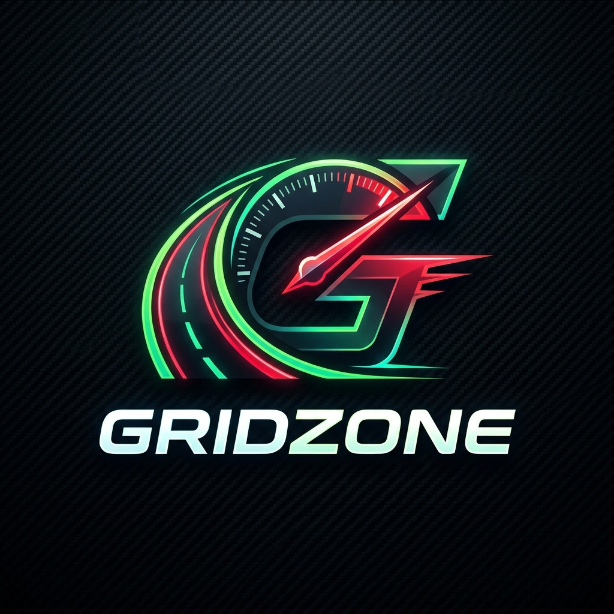

# 🏁 GridZone • Rede Social Automotiva & Eventos Reais do Brasil

  

Uma plataforma web progressiva (PWA) de alta performance desenvolvida sob medida para a cultura automotiva, preparação e entusiastas. Combina uma **rede social completa para gearheads**, telemetria de radar com GPS, **calendário oficial de eventos automotivos reais pelo Brasil ordenados por proximidade** e links diretos para compra de ingressos via Sympla e plataformas oficiais.

---

## 📅 Eventos Automotivos Reais do Brasil (Ordenados por Proximidade GPS)

- 📍 **Ordenação Automática por Distância:** O aplicativo calcula a distância exata em quilômetros de cada evento até a localização de cada usuário (`getDistanceBetween`), exibindo o mais próximo em primeiro com a insígnia `🏆 O MAIS PRÓXIMO DE VOCÊ`.
- 🎟️ **Compra Oficial de Ingressos:** Links diretos nos cards para as bilheterias oficiais e **Sympla**.
- 📸 **Instagram Oficial Verificado:** Links diretos para os perfis oficiais de cada evento (`@ultimatedriftbr`, `@bgtreffen`, `@crazyforauto`, `@listasbrasiloficial`, etc.).
- 💨 **Filtros por Modalidade:** Drift, Arrancada & Drag 402m, Track Day Interlagos, Encontros & VAG Euro Stance.

### 🏁 Principais Eventos Mapeados:

#### 📍 Região Mais Próxima (Marília & Bauru):
1. **Ryoukai Meet Marília (1ª Edição)** — Autódromo Municipal de Marília (Marília - SP) | Instagram: @ryoukaimeet | Ingressos: Uticket Oficial (uticket.com.br)
2. **Expo Dapper Style Bauru** — Recinto Mello Moraes (Bauru - SP) | Instagram: @dapper_style_oficial | Ingressos: Sympla Oficial (sympla.com.br/evento/expo-dapper-style/2290620)

#### 🏆 Grandes Campeonatos Nacionais & Interestaduais:
3. **SPID Cup • Arrancada Internacional (Padrão NHRA)** — SPID Dragway (Itatiba - SP) | Instagram: @spidcup | Ingressos: Bilheteria Oficial SPID (spidcup.com.br)
4. **Armageddon Arrancada No Prep** — Pistas Oficiais (Londrina / Race Park / Velopark) | Instagram: @listasbrasiloficial | Ingressos: Bilheteria Oficial Listas Brasil & Sympla
5. **Detailer Fest Brasil & Drift Show** — Centro de Eventos Boituva (Boituva - SP) | Instagram: @detailerfestbrasil | Ingressos: Sympla Oficial (sympla.com.br)
6. **Drag Fest Brasil (Arrancada 201m)** — Pista Force Car (Artur Nogueira - SP) | Instagram: @dragfestoficial | Ingressos: Sympla Oficial (sympla.com.br)
7. **Bubble Gun Treffen (BGT 14)** — Praça Adhemar de Barros (Águas de Lindóia - SP) | Instagram: @bgtreffen | Ingressos: Sympla Oficial VP97
8. **Crazy For Auto • Interlagos** — Autódromo de Interlagos (São Paulo - SP) | Instagram: @crazyforauto | Ingressos: Sympla Oficial
9. **Ultimate Drift Brasil** — Autódromo ECPA (Piracicaba - SP) & Mega Space | Instagram: @ultimatedriftbr | Ingressos: Bilheteria Oficial & Sympla (ultimatedrift.com.br)
10. **Encontro Brasileiro de Autos Antigos (EBAA)** — Praça Adhemar de Barros (Águas de Lindóia - SP) | Instagram: @encontroantigosaguasdelindoia | Acesso Gratuito Pedestres (encontroaguasdelindoia.com.br)
11. **VP Series de Arrancada Velopark** — Complexo Automobilístico Velopark (Nova Santa Rita - RS) | Instagram: @velopark | Ingressos: Sympla Oficial Velopark
---

## 🏎️ Outros Módulos Integrados

- **📸 Feed Social Gearhead:** Postagens de fotos, relatos de encontros, comentários e curtidas em tempo real.
- **🗺️ Radar Waze Live:** Telemetria GPS com velocímetro rigoroso e multiplayer via MQTT.
- **🛠️ Garagem & Ficha Técnica:** Gerenciamento de modificações instaladas, cavalaria e custos.
- **📱 PWA Nativo:** Instalável no smartphone com suporte a Service Worker e offline.

---

## 🌐 Acesso Online
👉 [**https://vctraphael.github.io/projeto-1/**](https://vctraphael.github.io/projeto-1/)
